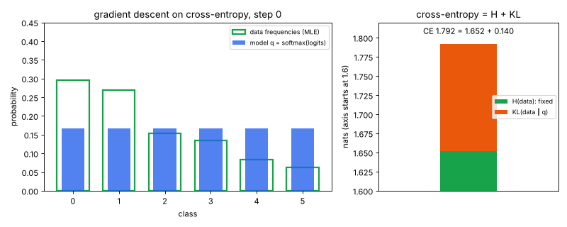
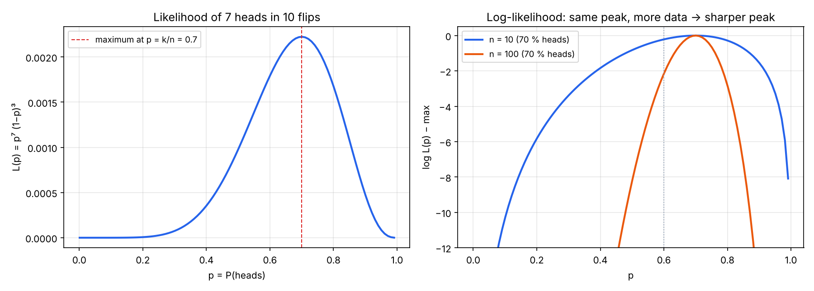
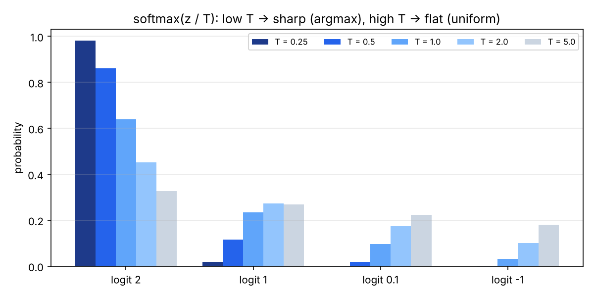
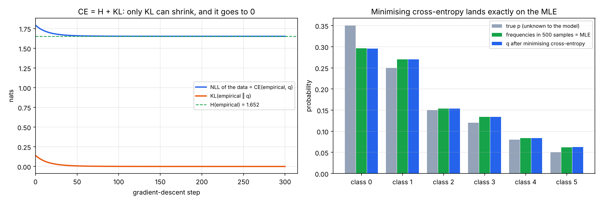
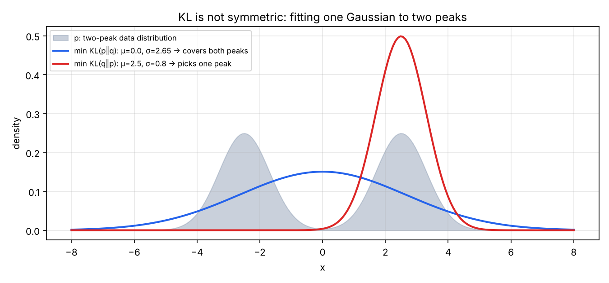

# 08 · MLE, softmax, cross-entropy & KL

🇸🇰 [Slovenská verzia](README.sk.md)

## TL;DR
The math minimum before P4 (GPT from scratch). Goal from the roadmap: *explain why minimising cross-entropy = maximum likelihood (MLE)*. Five small NumPy experiments (seed 0, every number from `results.json`):
- **MLE of a coin:** 7 heads in 10 flips → the likelihood peaks at **p = 0.700**, exactly k/n. With 10× more data at the same 70 %, moving p to 0.6 costs 10× more log-likelihood (2.160 vs 0.216).
- **Cross-entropy = MLE:**
  - The average negative log-likelihood of the data equals cross-entropy(data frequencies, model) for *any* model. The largest gap on 100 random models is 8.9e-16, i.e. float rounding.
  - Gradient descent on cross-entropy lands on the data frequencies, the MLE (max difference 4.7e-4 after 300 steps).
  - The loss stops at **1.652 nats = the entropy of the data**, because CE = H + KL and only KL can shrink.
- **Gradient of cross-entropy w.r.t. logits = softmax − one-hot**, matching finite differences to 1.75e-10.
- **Softmax:** shifting all logits by +1000 changes nothing mathematically, but the naive formula returns NaN for all 4 values; subtracting the max fixes it.
- **KL is not symmetric:** fitting one Gaussian to a two-peak distribution.
  - KL(p‖q) gives μ = 0, σ = 2.65, covering both peaks.
  - KL(q‖p) gives μ = 2.5, σ = 0.8, sitting on one peak.



## Problem
Every language model in P4 is trained by minimising "cross-entropy loss", and makemore in step 04 reported "NLL". Why is that the right loss, and what do the numbers mean? Four ideas are needed:
1. **Likelihood:** how probable the observed data is under a model, and choosing parameters that maximise it (MLE).
2. **Softmax:** turning a vector of arbitrary scores (logits) into a probability distribution.
3. **Cross-entropy:** the average surprise −log q(x) when data come from p but you predict with q.
4. **KL divergence:** the *extra* surprise caused by using q instead of p.

Sources: Mathematics for Machine Learning (ch. 6), Karpathy's makemore.

## How it works

### 1. Maximum likelihood (`coin_mle`)
For a coin with P(heads) = p, observing 7 heads and 3 tails has probability `L(p) = p⁷ (1−p)³`. MLE picks the p that makes the data most probable. We take the log, because a product of many small probabilities underflows to 0 while a sum of logs is stable, and log doesn't move the maximum:

```
log L(p) = 7 log p + 3 log(1−p)        d/dp = 7/p − 3/(1−p) = 0   →   p = 7/10
```
The grid search agrees: argmax 0.700. With 70 heads in 100 the peak is in the same place but much narrower. Moving to p = 0.6 costs 0.216 in log-likelihood with 10 flips and 2.160 with 100. More data means more certainty about p.



### 2. Softmax and temperature (`softmax`)
```python
def softmax(z, t=1.0):
    z = z / t
    e = np.exp(z - z.max())  # the max cancels in the ratio, but stops exp() from overflowing
    return e / e.sum()
```
- Exponentiation makes every score positive; dividing by the sum makes them add up to 1. The order is kept: a bigger logit means a bigger probability.
- **Temperature** divides the logits before softmax. For logits [2, 1, 0.1, −1]:
  - T = 0.25 gives the top class 98.2 % (almost argmax);
  - T = 1 gives 63.8 %;
  - T = 5 gives 32.8 % (almost uniform).

  This is the temperature knob used for sampling in P4.
- **Stability:** `exp(1002)` overflows to `inf`, and `inf / inf = NaN`. Since softmax(z + c) = softmax(z), subtracting the max gives identical results without overflow.



### 3. Cross-entropy = MLE (`ce_is_mle`)
Six classes with a true distribution p = [0.35, 0.25, 0.15, 0.12, 0.08, 0.05]. Draw 500 samples; their frequencies (the empirical distribution p̂) are [0.296, 0.270, 0.154, 0.134, 0.084, 0.062]. The model is q = softmax(z) with 6 free logits, starting at uniform.

**Why the two losses are the same thing:**
```
NLL(q) = −(1/n) Σᵢ log q(xᵢ)                     # average negative log-likelihood of the data
       = −Σₖ (countₖ / n) log q(k)                 # group the samples by class
       = −Σₖ p̂(k) log q(k) = H(p̂, q)               # cross-entropy between data and model
```
So maximising likelihood = minimising NLL = minimising cross-entropy against the data. The code checks this on 100 random models; the largest difference is 8.9e-16.

**Why it stops at the entropy:**
```
H(p̂, q) = H(p̂) + KL(p̂ ‖ q)          H(p̂) is fixed by the data, KL ≥ 0 and = 0 only when q = p̂
```
Gradient descent (lr = 0.2) drives KL from 0.140 (uniform q) to 0.021 after 30 steps and 0.001 after 99. The loss levels off at **1.652 nats = H(p̂)**, and q matches p̂ to 4.7e-4.

- The model learns the *sample* frequencies, not the true p: q(class 0) = 0.296, not 0.35. That is what MLE does, and why more data (or regularisation) matters.
- This also explains the numbers in step 04 (makemore): validation NLL is the cross-entropy on unseen names. exp(NLL) is the **perplexity**, "how many equally likely choices the model is torn between". Bigram NLL 2.462 means perplexity 11.7; MLP NLL 1.952 means 7.0.



### 4. The gradient: softmax − one-hot (`gradient_check`)
For one example with true class y, `loss = −log softmax(z)[y]`. Its derivative w.r.t. each logit is
```
∂loss/∂zₖ = softmax(z)ₖ − [k = y]
```
The analytic gradient matches central finite differences to 1.75e-10. Two things follow:
- The gradient is simply "predicted minus target". That is why the GD update in part 3 is `z -= lr * (q - p̂)`.
- The entries sum to 0: raising the right class always lowers the others.

### 5. KL is not symmetric (`kl_asymmetry`)
KL(p‖q) = Σ p log(p/q) is a "distance" that is not a distance: KL(p‖q) ≠ KL(q‖p). Fit a single Gaussian q to a mixture p of two peaks (at ±2.5, σ = 0.8) by grid search:

| Minimise | μ | σ | KL in that direction | KL in the other direction | Behaviour |
|---|---|---|---|---|---|
| KL(p‖q), "forward" | 0.0 | 2.65 | 0.498 | 1.011 | **mode-covering:** q must not be ~0 where p has mass, so it spreads over both peaks |
| KL(q‖p), "reverse" | 2.5 | 0.8 | 0.691 | 9.075 | **mode-seeking:** q must not put mass where p is ~0, so it hides inside one peak |

Forward KL is exactly what MLE / cross-entropy minimises (part 3). Its optimum matches the mixture's mean and std (2.625; the grid found 2.65). Reverse KL appears in variational inference and in the KL penalty of RLHF/DPO (P5).



## Results
| Check | Result | Expected |
|---|---|---|
| MLE of 7 heads / 10 | 0.700 | k/n = 0.7 |
| log-lik drop at p = 0.6, n = 10 vs 100 | 0.216 vs 2.160 | 10× |
| softmax(z + 1000), naive vs stable | NaN ×4 vs same as softmax(z) | shift-invariant |
| max \|NLL − CE(p̂, q)\|, 100 random q | 8.9e-16 | 0 |
| max \|q − p̂\| after 300 GD steps | 4.7e-4 | 0 (MLE) |
| final NLL vs H(p̂) | 1.6518 vs 1.6518 | CE = H + KL, KL → 0 |
| uniform model NLL | 1.792 = log 6 | upper bound |
| max \|analytic − numeric gradient\| | 1.75e-10 | 0 |
| forward / reverse KL fit (μ, σ) | (0.0, 2.65) / (2.5, 0.8) | cover vs seek |

## Visual example: why not the cars
The cars learn from rewards, crashes and imitation, but none of that shows "CE = H + KL" as clearly as a distribution you can watch move. The GIF at the top is the visual. The blue bars (the model's softmax) slide into the green outlines (the data frequencies, the MLE). On the right, the cross-entropy splits into a fixed entropy part and a KL part that melts to zero.

## What I learned
- Likelihood scores parameters given fixed data; taking the log turns a product into a sum and keeps the maximum.
- For a categorical distribution, the MLE is just the frequencies, and gradient descent on cross-entropy finds them.
- "Cross-entropy loss", "negative log-likelihood" and "KL to the data + a constant" are the same objective. The constant (data entropy) is the floor the loss can never beat, which is why an LM's loss never goes to 0.
- Softmax + cross-entropy has the nicest possible gradient: prediction − target.
- Always compute softmax / log-softmax with the max subtracted.
- KL direction matters: forward covers all modes (MLE), reverse picks one (RLHF penalty, variational inference).

## Run it
```bash
uv sync
uv run python mle.py     # experiments → results.json (prints the key checks)
uv run python plot.py    # assets/coin.png, softmax.png, ce_mle.png, kl.png, ce_training.gif
```

## Limitations
- Toy distributions with 6 classes and 1-D Gaussians; real models have millions of logits, but the algebra is identical.
- No PyTorch here: the gradient is checked with finite differences instead of autograd.
- The KL fits use a grid search (step 0.05), so σ = 2.65 vs the exact moment-matching value 2.625 is grid resolution.
