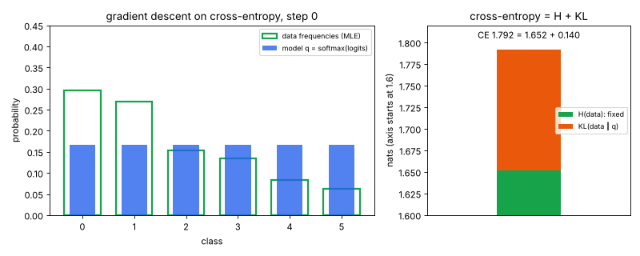
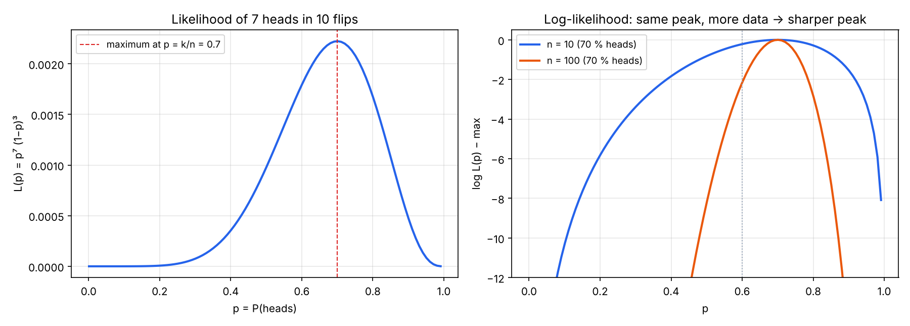
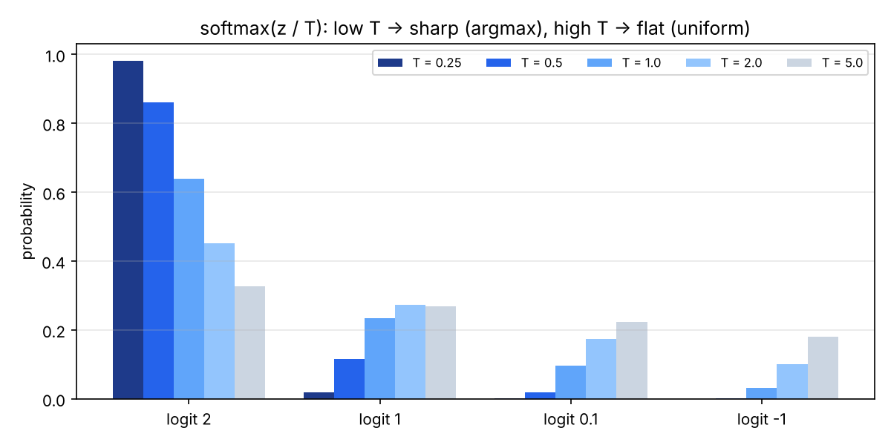
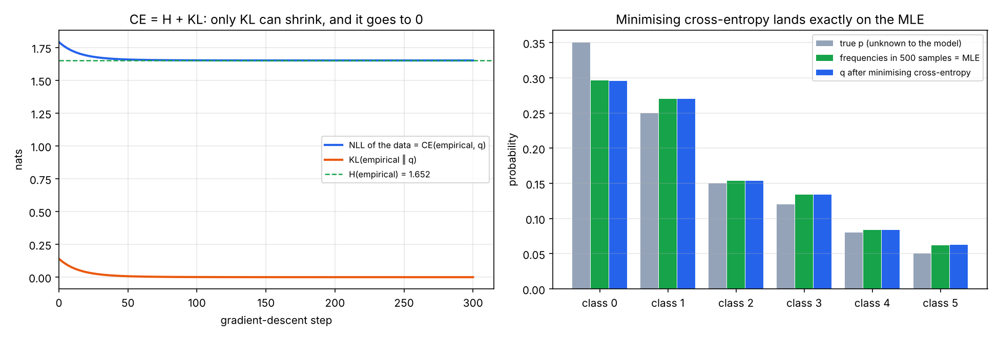
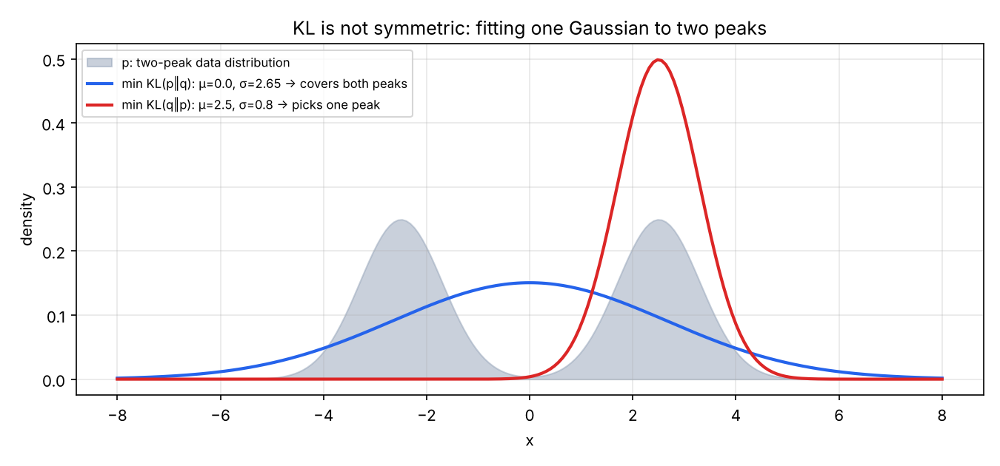

# 08 · MLE, softmax, cross-entropy a KL

🇬🇧 [English version](README.md) · 📘 [Tutoriál krok za krokom](TUTORIAL.sk.md)

## TL;DR
Matematické minimum pred P4 (GPT od nuly). Cieľ podľa roadmapy: *vysvetliť, prečo minimalizácia cross-entropy = maximálna vierohodnosť (MLE)*. Päť malých experimentov v NumPy (seed 0, každé číslo z `results.json`):
- **MLE pre mincu:** 7 hláv z 10 hodov → vierohodnosť má vrchol pri **p = 0,700**, presne k/n. Pri 10× viac dátach s rovnakými 70 % stojí posun p na 0,6 10× viac log-vierohodnosti (2,160 vs 0,216).
- **Cross-entropy = MLE:**
  - Priemerná záporná log-vierohodnosť dát sa rovná cross-entropy(frekvencie v dátach, model) pre *akýkoľvek* model. Najväčší rozdiel na 100 náhodných modeloch je 8,9e-16, teda zaokrúhľovanie floatov.
  - Gradient descent na cross-entropy skončí na frekvenciách v dátach, čo je MLE (max. rozdiel 4,7e-4 po 300 krokoch).
  - Loss sa zastaví na **1,652 nats = entropia dát**, lebo CE = H + KL a zmenšiť sa dá len KL.
- **Gradient cross-entropy podľa logitov = softmax − one-hot**, zhoda s konečnými diferenciami na 1,75e-10.
- **Softmax:** posun všetkých logitov o +1000 matematicky nič nemení, ale naivný vzorec vráti NaN pre všetky 4 hodnoty; odčítanie maxima to opraví.
- **KL nie je symetrická:** fit jednej Gaussovky na rozdelenie s dvoma vrcholmi.
  - KL(p‖q) dá μ = 0, σ = 2,65, teda pokryje oba vrcholy.
  - KL(q‖p) dá μ = 2,5, σ = 0,8, teda sadne na jeden vrchol.



## Najprv jednoducho
Predstav si mincu, ktorá padla 7-krát na hlavu z 10 hodov. Rozumný odhad jej šance na hlavu je 7/10. **Maximum likelihood (MLE)** znamená vybrať také nastavenie modelu, pri ktorom by pozorované dáta boli najpravdepodobnejšie. Prvý pokus v skripte ukáže, prečo vyhrá práve 0,7.

Jazykový model robí podobnú vec, len namiesto mince odhaduje pravdepodobnosť ďalšieho tokenu. Najprv má ľubovoľné skóre pre možné odpovede; **softmax** ich premení na pravdepodobnosti. Ak správnej odpovedi priradí malú pravdepodobnosť, dostane veľkú chybu. Priemerná chyba sa volá **cross-entropy**. Minimalizovať ju znamená dávať skutočným odpovediam čo najvyššiu pravdepodobnosť — teda robiť MLE.

Skript tieto tvrdenia overí na číslach, ukáže, ako sa model učením približuje k pozorovaným frekvenciám, a porovná dva smery **KL divergencie** (mieru rozdielu medzi rozdeleniami). Graf animuje pokles chyby. Dôležitý výsledok: výber správnej chybovej funkcie nie je kúzlo, ale spôsob, ako matematicky odmeňovať pravdepodobné správne predpovede.

## Problém
Každý jazykový model v P4 sa trénuje minimalizáciou „cross-entropy loss“ a makemore v kroku 04 reportoval „NLL“. Prečo je to správny loss a čo tie čísla znamenajú? Treba štyri myšlienky:
1. **Vierohodnosť (likelihood):** aké pravdepodobné sú pozorované dáta podľa modelu, a voľba parametrov, ktoré ju maximalizujú (MLE).
2. **Softmax:** premena vektora ľubovoľných skóre (logitov) na rozdelenie pravdepodobnosti.
3. **Cross-entropy:** priemerné prekvapenie −log q(x), keď dáta prichádzajú z p, ale predpovedáš pomocou q.
4. **KL divergencia:** prekvapenie *navyše*, ktoré spôsobí použitie q namiesto p.

Zdroje: Mathematics for Machine Learning (kap. 6), Karpathyho makemore.

## Ako to funguje

### 1. Maximálna vierohodnosť (`coin_mle`)
Pre mincu s P(hlava) = p má pozorovanie 7 hláv a 3 znakov pravdepodobnosť `L(p) = p⁷ (1−p)³`. MLE vyberie p, pri ktorom sú dáta najpravdepodobnejšie. Berieme logaritmus, lebo súčin veľa malých pravdepodobností podtečie na 0, kým súčet logaritmov je stabilný, a logaritmus maximum neposunie:

```
log L(p) = 7 log p + 3 log(1−p)        d/dp = 7/p − 3/(1−p) = 0   →   p = 7/10
```
Hľadanie na mriežke súhlasí: argmax 0,700. Pri 70 hlavách zo 100 je vrchol na rovnakom mieste, ale oveľa užší. Posun na p = 0,6 stojí 0,216 log-vierohodnosti pri 10 hodoch a 2,160 pri 100. Viac dát znamená väčšiu istotu o p.



### 2. Softmax a teplota (`softmax`)
```python
def softmax(z, t=1.0):
    z = z / t
    e = np.exp(z - z.max())  # maximum sa v podiele vykráti, ale zabráni pretečeniu exp()
    return e / e.sum()
```
- Exponenciála spraví každé skóre kladným; delenie súčtom zabezpečí, že dajú dokopy 1. Poradie sa zachová: väčší logit znamená väčšiu pravdepodobnosť.
- **Teplota** delí logity pred softmaxom. Pre logity [2, 1, 0,1, −1]:
  - T = 0,25 dá najväčšej triede 98,2 % (takmer argmax);
  - T = 1 dá 63,8 %;
  - T = 5 dá 32,8 % (takmer rovnomerné).

  To je gombík teploty pri samplovaní v P4.
- **Stabilita:** `exp(1002)` pretečie na `inf` a `inf / inf = NaN`. Keďže softmax(z + c) = softmax(z), odčítanie maxima dá rovnaký výsledok bez pretečenia.



### 3. Cross-entropy = MLE (`ce_is_mle`)
Šesť tried so skutočným rozdelením p = [0,35, 0,25, 0,15, 0,12, 0,08, 0,05]. Vytiahneme 500 vzoriek; ich frekvencie (empirické rozdelenie p̂) sú [0,296, 0,270, 0,154, 0,134, 0,084, 0,062]. Model je q = softmax(z) so 6 voľnými logitmi, štartuje z rovnomerného rozdelenia.

**Prečo sú oba lossy to isté:**
```
NLL(q) = −(1/n) Σᵢ log q(xᵢ)                     # priemerná záporná log-vierohodnosť dát
       = −Σₖ (countₖ / n) log q(k)                 # zoskup vzorky podľa triedy
       = −Σₖ p̂(k) log q(k) = H(p̂, q)               # cross-entropy medzi dátami a modelom
```
Maximalizovať vierohodnosť = minimalizovať NLL = minimalizovať cross-entropy voči dátam. Kód to overí na 100 náhodných modeloch; najväčší rozdiel je 8,9e-16.

**Prečo sa zastaví na entropii:**
```
H(p̂, q) = H(p̂) + KL(p̂ ‖ q)          H(p̂) je daná dátami, KL ≥ 0 a = 0 len keď q = p̂
```
Gradient descent (lr = 0,2) stiahne KL z 0,140 (rovnomerné q) na 0,021 po 30 krokoch a 0,001 po 99. Loss sa ustáli na **1,652 nats = H(p̂)** a q sa zhoduje s p̂ na 4,7e-4.

- Model sa naučí frekvencie vo *vzorke*, nie skutočné p: q(trieda 0) = 0,296, nie 0,35. Presne to robí MLE, a preto záleží na množstve dát (alebo regularizácii).
- Vysvetľuje to aj čísla z kroku 04 (makemore): validačné NLL je cross-entropy na nevidených názvoch. exp(NLL) je **perplexita**, „medzi koľkými rovnako pravdepodobnými voľbami model váha“. Bigram NLL 2,462 znamená perplexitu 11,7; MLP NLL 1,952 znamená 7,0.



### 4. Gradient: softmax − one-hot (`gradient_check`)
Pre jeden príklad so skutočnou triedou y je `loss = −log softmax(z)[y]`. Jeho derivácia podľa každého logitu je
```
∂loss/∂zₖ = softmax(z)ₖ − [k = y]
```
Analytický gradient sa zhoduje s centrálnymi konečnými diferenciami na 1,75e-10. Z toho vyplývajú dve veci:
- Gradient je jednoducho „predikcia mínus cieľ“. Preto je GD krok v časti 3 `z -= lr * (q - p̂)`.
- Zložky dajú dokopy 0: zvýšenie správnej triedy vždy zníži ostatné.

### 5. KL nie je symetrická (`kl_asymmetry`)
KL(p‖q) = Σ p log(p/q) je „vzdialenosť“, ktorá nie je vzdialenosťou: KL(p‖q) ≠ KL(q‖p). Jednu Gaussovku q fitneme na zmes p s dvoma vrcholmi (v ±2,5, σ = 0,8) hľadaním na mriežke:

| Minimalizuj | μ | σ | KL v tom smere | KL v opačnom smere | Správanie |
|---|---|---|---|---|---|
| KL(p‖q), „forward“ | 0,0 | 2,65 | 0,498 | 1,011 | **pokrýva módy:** q nesmie byť ~0 tam, kde má p hmotu, tak sa roztiahne cez oba vrcholy |
| KL(q‖p), „reverse“ | 2,5 | 0,8 | 0,691 | 9,075 | **hľadá módus:** q nesmie dať hmotu tam, kde je p ~0, tak sa schová do jedného vrcholu |

Forward KL je presne to, čo minimalizuje MLE / cross-entropy (časť 3). Jeho optimum zodpovedá priemeru a smerodajnej odchýlke zmesi (2,625; mriežka našla 2,65). Reverse KL sa objavuje vo variačnej inferencii a v KL penalizácii pri RLHF/DPO (P5).



## Výsledky
| Kontrola | Výsledok | Očakávané |
|---|---|---|
| MLE pre 7 hláv / 10 | 0,700 | k/n = 0,7 |
| pokles log-vierohodnosti pri p = 0,6, n = 10 vs 100 | 0,216 vs 2,160 | 10× |
| softmax(z + 1000), naivný vs stabilný | NaN ×4 vs rovnaké ako softmax(z) | invariantné voči posunu |
| max \|NLL − CE(p̂, q)\|, 100 náhodných q | 8,9e-16 | 0 |
| max \|q − p̂\| po 300 GD krokoch | 4,7e-4 | 0 (MLE) |
| konečné NLL vs H(p̂) | 1,6518 vs 1,6518 | CE = H + KL, KL → 0 |
| NLL rovnomerného modelu | 1,792 = log 6 | horná hranica |
| max \|analytický − numerický gradient\| | 1,75e-10 | 0 |
| fit forward / reverse KL (μ, σ) | (0,0, 2,65) / (2,5, 0,8) | pokrytie vs hľadanie |

## Vizuálny príklad: prečo nie autíčka
Autíčka sa učia z odmien, nabúraní a napodobňovania, ale nič z toho neukáže „CE = H + KL“ tak jasne ako rozdelenie, na ktoré sa dá pozerať, ako sa hýbe. Vizuálom je GIF hore. Modré stĺpce (softmax modelu) sa vsunú do zelených obrysov (frekvencie v dátach, MLE). Vpravo sa cross-entropy rozdelí na pevnú časť entropie a časť KL, ktorá sa roztopí na nulu.

## Čo som sa naučil
- Vierohodnosť hodnotí parametre pri pevných dátach; logaritmus premení súčin na súčet a maximum zachová.
- Pre kategorické rozdelenie je MLE jednoducho frekvencia a gradient descent na cross-entropy ju nájde.
- „Cross-entropy loss“, „záporná log-vierohodnosť“ a „KL k dátam + konštanta“ sú ten istý cieľ. Konštanta (entropia dát) je dno, ktoré loss nikdy neprekoná, a preto loss jazykového modelu nikdy neklesne na 0.
- Softmax + cross-entropy má najkrajší možný gradient: predikcia − cieľ.
- Softmax / log-softmax vždy počítaj s odčítaným maximom.
- Na smere KL záleží: forward pokryje všetky módy (MLE), reverse vyberie jeden (penalizácia v RLHF, variačná inferencia).

## Spustenie
```bash
uv sync
uv run python mle.py     # experimenty → results.json (vypíše hlavné kontroly)
uv run python plot.py    # assets/coin.png, softmax.png, ce_mle.png, kl.png, ce_training.gif
```

## Obmedzenia
- Hračkárske rozdelenia so 6 triedami a 1-D Gaussovkami; skutočné modely majú milióny logitov, ale algebra je rovnaká.
- Bez PyTorchu: gradient je overený konečnými diferenciami, nie autogradom.
- KL fity používajú hľadanie na mriežke (krok 0,05), takže σ = 2,65 oproti presnej hodnote 2,625 je rozlíšenie mriežky.
